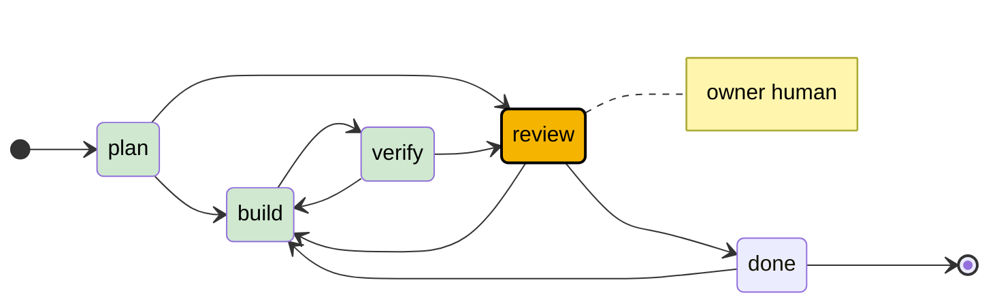

# Architecture skeleton and mechanical constraints

## Goal
Constrain other agents so results are verifiable and consistent: lock the code's shape in a skeleton, enforce it with checks, and make tests deterministic

## Plan
Write the skeleton the issues fill: module boundaries, types and signatures with notImplemented bodies, ports for time and ids. Enforce with lint and a chart-vs-table script. Add the harnesses for pair-table, contract and seeded model-based tests. Stacked on PR #1 as PR #2.

## Tasks
- [x] record D17-D20 (owner 2026-11-16) in ARCHITECTURE.md
- [x] skeleton: types, signatures, notImplemented bodies
- [x] ports: Clock and Ids injected; determinism lint ban
- [x] lint boundaries: feature internals, pg, fetch, storage
- [x] transition tables + check-state-machines script with negative control
- [x] machine pair-table test helper + model-test harness
- [x] contract-test helper (responses parsed by shared schemas)
- [x] AGENTS.md and issues point at the skeleton
- [x] lockfile + CI green on both platforms

## Handoff
From: claude
To: human
For: review
Next: Merge PR #1, then the skeleton PR; then an agent can take any ready:antigravity issue

## Walkthrough
What changed for the next agent: the code's shape exists (feature modules, every signature, notImplemented('#issue') bodies), and CI fails when an agent breaks it. Issues #2-#10 and #15 each carry a "Skeleton" section naming the functions to fill and the test helpers to use.

Evidence (CI run 43847761057, PR #14, Ubuntu and Windows): lint rules "16 cases behave as D20 says"; "state machines: 3 charts match their tables"; vitest shared 5/5, api 14/14 (4 files), web 4/4; e2e job success.
Negative controls: check-state-machines.mjs exit 1 for a removed row, an added row, an orphan table (run locally); checkMachine fails on an undrawn pair changed and a kind without a sample (machine.test.ts); check-lint-rules.mjs is the negative control for every lint rule.
Not done: the model-based test itself (#15, blocked by #7); fast-check not yet a dependency (added by #5 or #15).

## State
<!-- chart:start (generated by state.py, do not edit) -->

<!-- chart:end -->
