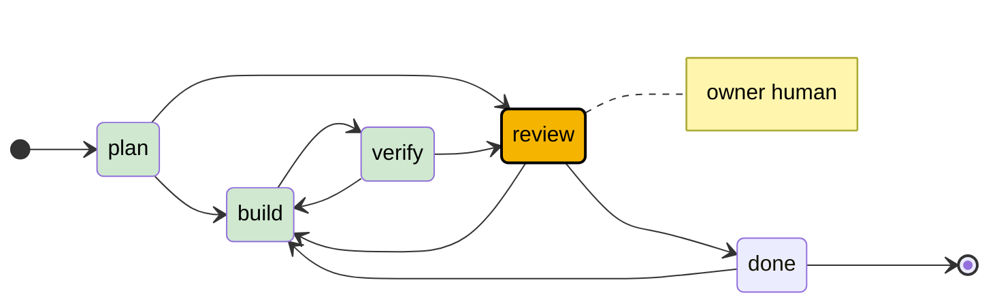

# Audit Antigravity's first batch and refill the queue

## Goal
Independent verdict on the merged issue work, close what meets its gate, refill the ready:antigravity queue

## Plan
Gate lines, test diff, negative control via dispatched CI on a revert branch, both platforms; close or send back; unblock; refill.

## Tasks
- [x] step 1: List the batch: branches not yet merged into the integration branch, open tasks in `state.py status --owner <other agent>`, and issues labelled for review.
- [x] step 2: Per branch, in a separate worktree when another agent is active:
- [x] step 3: Fix small problems in a follow-up commit.
- [-] step 4: Merge what passes into the integration branch and run the full suite once. -- skip: the owner had already merged every PR into main; nothing to merge
- [x] step 5: Close issues only with gate evidence in the closing comment, and only as the reviewer, never as the builder.
- [x] step 6: Refill the queue: about ten issues that meet the Definition of Ready (step 2 of the Handoff playbook), outside the project's risky areas.
- [x] step 7: Look for repeats.

## Handoff
From: claude
To: human
For: review
Next: Merge the audit PR; delete try/audit-negative-control and the old stack branches

## Walkthrough
Batch: #2 (PR #18), merged by the owner. Verdict: gate met; closed with evidence. Negative control: CI run 44005625657 on try/audit-negative-control fails the 5 password tests (Not implemented yet: #2), 14 others pass. Challenger: Antigravity's PASS on PR #18 and my review agree. Findings: reporting (garbled backticks, CI 'triggered') -> AGENTS.md step 5. Unblocked #3. Ready queue: #3, #5, #6, #8, #9, #10, #19, #20.

## State
<!-- chart:start (generated by state.py, do not edit) -->

<!-- chart:end -->
