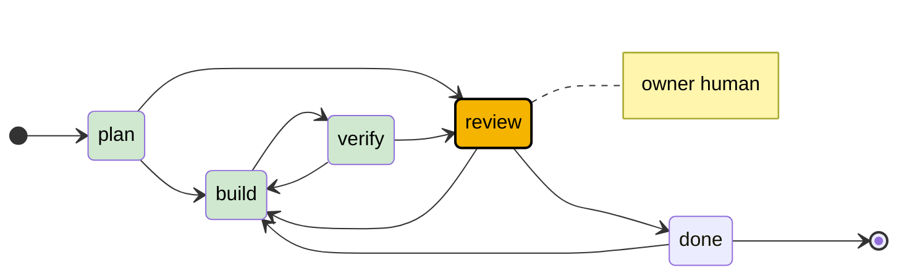

# Audit LocationManagement batch (8 PRs), merge, refill

## Goal
Review the eight Antigravity PRs, merge what passes, close their issues with evidence, open the next issues

## Plan
Challenger read for auth, parser, ZIP; integration branch merges all eight, lockfile regenerated once; negative controls on three try branches (one per workspace); batch PR with closing keywords; owner authorised merging.

## Tasks
- [x] step 1: List the batch: branches not yet merged into the integration branch, open tasks in `state.py status --owner <other agent>`, and issues labelled for review.
- [x] step 2: Per branch, in a separate worktree when another agent is active:
- [x] step 3: Fix small problems in a follow-up commit.
- [x] step 4: Merge what passes into the integration branch and run the full suite once.
- [x] step 5: Close issues only with gate evidence in the closing comment, and only as the reviewer, never as the builder.
- [x] step 6: Refill the queue: about ten issues that meet the Definition of Ready (step 2 of the Handoff playbook), outside the project's risky areas.
- [x] step 7: Look for repeats.

## Handoff
From: claude
To: human
For: review
Next: none: merged

## Walkthrough
Batch of eight PRs merged as #31 (5ddf6bf); issues #3 #5 #6 #8 #9 #10 #19 #20 closed with evidence; negative controls runs 44011406020, 44011793617, 44011790995. Follow-ups #32-#36.

## State
<!-- chart:start (generated by state.py, do not edit) -->

<!-- chart:end -->
