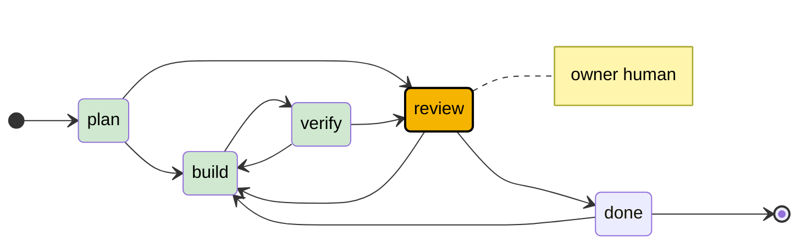

# Infra, CI and agent workflow for LocationManagement

## Goal
Set up infra and CI/CD like awan-lang and Awanfs, map the backend design (API, errors), and leave docs, issues and AGENTS.md so another AI can continue

## Plan
Copy Awanfs's shape (GitHub-hosted ubuntu+windows matrix, docker image on v* tags, lockfile workflow, Definition-of-Ready issues, iskandar-mode agent rules), cut to what an assessment app needs. No formal verification (owner 2026-11-16). Scaffold is minimal; features are issues.

## Tasks
- [x] agent rules: AGENTS.md, CLAUDE.md, .claude/settings.json, issue-writing skill
- [x] design docs: ARCHITECTURE decisions, API contract, error model, statecharts
- [x] scaffold: npm workspaces api/web/shared with health route and one test each
- [x] CI: ci.yml (ubuntu+windows), docker.yml, lockfile.yml
- [x] labels, issue templates, PR template
- [x] file Definition-of-Ready issues
- [x] owner OK to push; push; dispatch lockfile + CI; record run evidence

## Handoff
From: claude
To: human
For: review
Next: Review and merge PR #1; then set branch protection on main; schedule the design session
Open questions: Enable branch protection on main requiring the CI checks?

## Walkthrough
What a user of this work gets: a repo where any agent can pick a `ready:antigravity` issue, build it test-first, and get Ubuntu + Windows CI, Docker + Playwright e2e, and docs that state the contract (API, errors, state machines, decisions).

Evidence
- CI run 43841737188 (PR #1, before the docs-only commits): Test (ubuntu-latest) success, Test (windows-latest) success, Stack in Docker + end to end success. From the logs: shared 5/5 tests, api 10/10 in 3 files against real Postgres, web 1/1, build ok, Playwright 1 passed; Windows started the preinstalled PostgreSQL ("accepting connections", CREATE ROLE, CREATE DATABASE).
- Lockfile run 43841437917 success -> e858bc2 package-lock.json.
- node scripts/check-docs.mjs -> "docs: links ok"; negative control (broken link, C:\ link) -> exit 1. check-skill-mirror negative control -> exit 1.
- Issues #2-#13 filed with milestones M1-M4; #2, #5, #6, #8, #9, #10 labelled ready:antigravity; #3, #4, #7 blocked; #11 design session needs the owner.

Found and fixed: workflow_dispatch answers 404 for a workflow not on main (lockfile.yml added to main with owner OK; trap in AGENTS.md).
Not done: branch protection on main (owner setting); M2 design session (#11).

## State
<!-- chart:start (generated by state.py, do not edit) -->

<!-- chart:end -->
