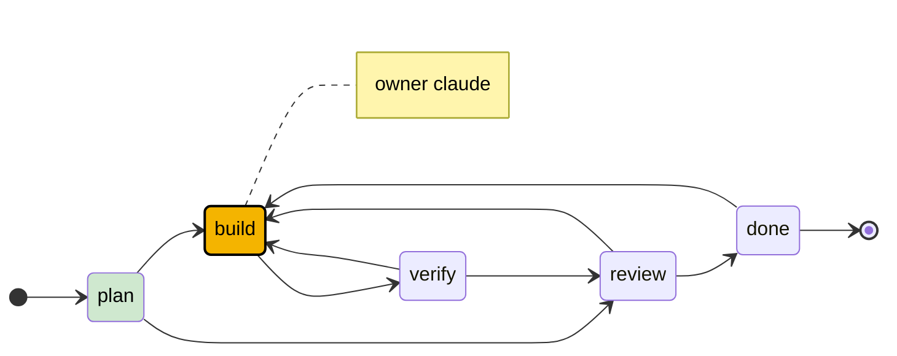

# Upload and auth limits, RATE_LIMITED, audit and Dependabot

## Goal
No size or count from a client is trusted: every upload and auth path has a hard limit, floods get 429, and native dependencies stay patched

## Plan
Owner 2026-11-17 chose a concurrency cap and per-user/IP rate limits (new 429 RATE_LIMITED) plus npm audit in CI and Dependabot. This PR: D21 and a Limits table, the code in ERRORS.md/errors.ts/API.md, a clock-driven limiter skeleton in http/limits.ts, the audit step, dependabot.yml. Issues fill the limiter and wire it.

## Tasks
- [x] step 1: `how` over the affected subsystem.
- [x] step 2: `architect` for parallel design exploration.
- [x] step 3: Write the throughput checkpoint as four todo items.
- [x] step 4: Delegate code-writing to a subagent using your configured feature model (default `grok-4.7-xhigh-fast`) with a specific scope (file paths, named data shape and its organizing structure per **principle
- [ ] step 5: Verify on the matching surface.
- [ ] step 6: Rebase into small, ordered commits.
- [ ] step 7: If the design is contested, `interrogate` before shipping.
- [ ] step 8: Run **Opening a PR**.
- [ ] D21, Limits table, RATE_LIMITED in code and docs
- [ ] limiter skeleton http/limits.ts (#36 fills)
- [ ] npm audit in CI, Dependabot
- [ ] issues #35 (lying header), #36, #37; #7 multipart limits
- [ ] CI green

## Handoff

## Walkthrough

## State
<!-- chart:start (generated by state.py, do not edit) -->

<!-- chart:end -->
