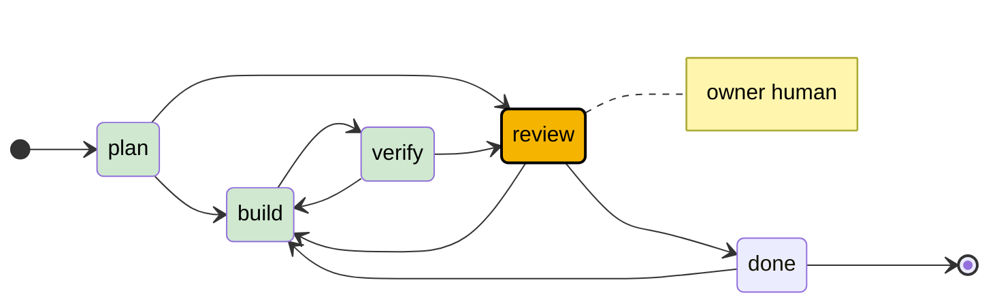

# UI snapshots, UX flows with step budgets, bug and UX feedback loop

## Goal
Owner sees UI snapshots in PRs and issues, files bugs and UX feedback with screenshots, navigates and edits UX flows with step budgets, and reviews and comments on issues

## Plan
docs/UX_FLOWS.md is the owner-editable source (screens, flows, budgets, map). e2e/screens.ts captures each built state; flow specs count steps against the doc's budget and save a filmstrip. ui-snapshots.yml pushes PNGs to the ui-snapshots branch and upserts one PR comment (before/after); dispatch posts screens on any issue. Bug and UX feedback forms; ui-evidence skill for agents; check-ux.mjs keeps doc and code in step.

## Tasks
- [x] UX_FLOWS.md: step rule, screens, flows with budgets, map, how the owner takes part
- [x] e2e: screens catalog, snapshots spec, flow helper counting steps
- [x] check-ux.mjs with negative controls
- [x] ui-snapshots.yml: capture, publish to ui-snapshots branch, upsert PR comment, dispatch to an issue
- [x] issue forms: bug, UX feedback; labels; PR template UI section
- [x] ui-evidence skill for agents; AGENTS.md review rule
- [-] todo: react-native-web render, static server, stubbed API, e2e job -- skip: the todo half lives in the todo repo (PR #10)
- [x] CI green; snapshot comment posted on the PR

## Handoff
From: claude
To: human
For: review
Next: Merge PRs in order; add todo's new required check; try Run workflow on an issue

## Walkthrough
CI run 43849611523 (PR #16) success. UI snapshots run 43849611430 posted the PR comment; pr-16 S0.home desktop PNG 9747 bytes, phone PNG 390x844 shows the page. check-ux: 14 states, 7 flows match; negative controls (status drift, missing state, spec for planned flow, enforced without spec) each exit 1.

Not done: "Run workflow" (posting screens on an issue) appears in Actions only after ui-snapshots.yml reaches main. No page is built yet, so only S0.home is captured and no flow is enforced.

## State
<!-- chart:start (generated by state.py, do not edit) -->

<!-- chart:end -->
