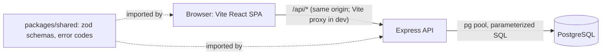
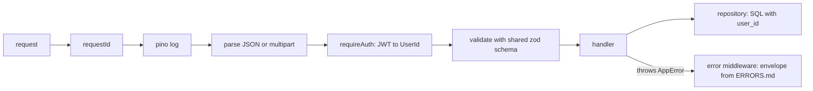
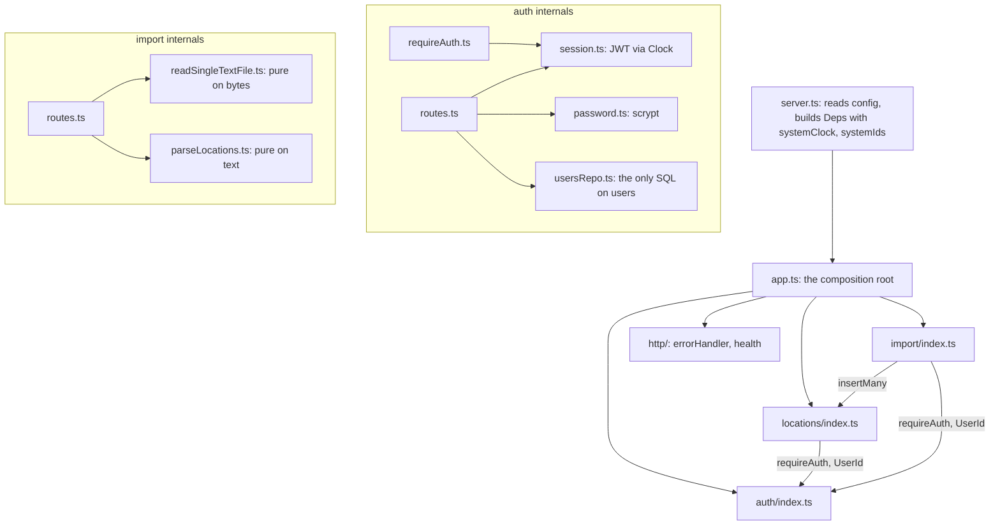

# Architecture and decisions

Each decision has an id. Status is one of `decided (who, date)`, `proposed` (Claude's
recommendation, holds until the owner says otherwise) or `open` (an issue labelled
`needs-decision` waits for it). A test never reverses a decision; a changed decision is edited
here first, in the same commit as the code that follows it.

## The system

A request through the API:

## Decisions

| Id | Decision | Status |
|---|---|---|
| D1 | TypeScript everywhere. Web: Vite + React, Tailwind, react-router, Zustand, react-leaflet. API: Node 22, Express 5. Database: PostgreSQL 16. | decided (owner, 2026-11-16) |
| D2 | One repository, npm workspaces: `apps/api`, `apps/web`, `packages/shared`. | proposed |
| D3 | CI like Awanfs: Ubuntu and Windows, real Postgres in tests, e2e, Docker image. No formal verification: nothing here is concurrent or a protocol worth a model. | decided (owner, 2026-11-16) |
| D4 | Data access with `pg` and plain SQL; migrations are numbered `.sql` files run by a 40-line runner in `apps/api/src/db/migrate.ts`. | proposed |
| D5 | Passwords are hashed with `node:crypto` `scrypt` (N=16384, r=8, p=1, 16-byte salt, 64-byte key) and compared with `timingSafeEqual`. | proposed |
| D6 | The JWT travels in an httpOnly cookie: `session=<jwt>; HttpOnly; SameSite=Strict; Path=/api`, plus `Secure` when `COOKIE_SECURE=true` (set it wherever the site is served over HTTPS). HS256, 1 hour, no refresh tokens. The web learns the user from `GET /api/auth/me`. | decided (owner, 2026-11-16) |
| D7 | User isolation: the user id comes only from the verified JWT `sub`. Repository functions take it as their first argument and every SQL statement on `locations` filters on it. A location of another user answers 404, never 403. | proposed |
| D8 | Upload: `POST /api/locations/import`, `multipart/form-data`, one field `file`, read into memory by `multer` with a 1 MiB limit. The import is one transaction: all rows or none. | proposed |
| D9 | A ZIP passes when, after ignoring directory entries, `__MACOSX/` and `.DS_Store`, exactly one file is left and it is a `.txt` file (rules below). | decided (owner, 2026-11-16) |
| D10 | How the text file is parsed. | proposed |
| D11 | Coordinates are `double precision` columns with `CHECK` constraints for range; the sample has 9 decimal places, which `numeric(9,6)` would round. | proposed |
| D12 | A location added by the form appears after the API answers 201 (with its id), not optimistically. The submit button is disabled while saving. | proposed |
| D13 | What the web does in the three seconds after a successful upload. | **open** (frontend design session) |
| D14 | Tests: Vitest in api and web, supertest against a real Postgres (no database mocks), Playwright end to end against `docker compose`. Extended by D18. | proposed |
| D15 | Config is read once at start from the environment and validated with zod; the API refuses to start without `DATABASE_URL` and a `JWT_SECRET` of at least 32 characters. | proposed |
| D16 | `package-lock.json` is committed and CI runs `npm ci`. A session without network changes dependencies through the `lockfile` workflow (as Awanfs decision 17). | proposed |
| D17 | The API is feature modules with a pure core: `auth/`, `locations/`, `import/`, each with one public `index.ts`. Inside a feature, pure functions decide (parse, validate, compare) and one repository file runs its SQL. `app.ts` is the only composition root; features receive `Deps`. The skeleton fixes every signature; issues fill bodies. | decided (owner, 2026-11-16) |
| D18 | Tests are deterministic. Time and ids come from the `Clock` and `Ids` ports in `apps/api/src/ports.ts`; tests use `fixedClock` and `sequentialIds`. A seeded model-based test runs random command sequences for several users against the real API on Postgres and against `test/model/referenceModel.ts`, and compares what each user sees after every command. A failure prints the seed that replays it. Full simulation (simulated database, network, scheduler) was considered and rejected: nothing here is concurrent or distributed. | decided (owner, 2026-11-16) |
| D19 | Frontend state machines are reducers over discriminated unions with the transition table exported as data (`apps/web/src/lib/machine.ts`). Considered: XState (a dependency and a learning curve for assessors), stores with flags (the drift this avoids). | decided (owner, 2026-11-16) |
| D20 | The architecture is enforced by checks, not by prose. The list is in "What enforces it" below; a new rule goes there and into CI in the same change. | decided (owner, 2026-11-16) |

## Module map (D17)

| Rule | Why | Enforced by |
|---|---|---|
| Code outside a feature imports only its `index.ts` | One public surface per feature; internals can change freely | lint: `no-restricted-imports` patterns |
| Only `db/pool.ts` creates a pool; features get `Deps.db` | Tests swap the database; no hidden connections | lint: `pg` value imports banned elsewhere |
| SQL on `locations` only in `locations/repo.ts`, on `users` only in `auth/usersRepo.ts`; every function takes `UserId` first | D7 isolation by construction | type: `UserId` is branded, `asUserId` is not exported; the #4 gate's source check |
| Time and ids only through `Deps.clock` and `Deps.ids` | D18 replayable tests | lint: `Date.now()`, `new Date()`, `Math.random()`, `randomUUID` banned outside `ports.ts` |
| Only `http/errorHandler.ts` writes error bodies | One envelope (`docs/ERRORS.md`) | lint: `res.status(4xx/5xx).json` banned elsewhere |
| Parsers and deciders are pure | Property tests need no database | review; their tests run without `Deps` |
| Only `apps/web/src/api/client.ts` calls `fetch` | One place turns responses into `ApiError` | lint: `no-restricted-globals` |

## What enforces it (D20)

| Check | Command (all in `npm run ci`) | Fails when |
|---|---|---|
| Lint | `npm run lint` | A rule in the module map is broken |
| Lint rules themselves | `node scripts/check-lint-rules.mjs` | A rule stops reporting its known violation, or reports an allowed case |
| Types | `npm run typecheck` | A skeleton signature is changed in one place only |
| Contract | `expectBody(res, status, Schema)` in `apps/api/test/helpers.ts` | A response has another status or does not parse with the strict shared schema (an extra field such as a token fails) |
| Error codes | `apps/api/test/errors.test.ts` | `docs/ERRORS.md` and `ERROR_CODES` differ |
| Charts vs tables | `node scripts/check-state-machines.mjs` | A chart and its transition table differ, or a table has no chart |
| Reducers vs tables | `checkMachine` (`apps/web/src/test/machine.ts`) | A reducer leaves its table, or a state, event or row has no sample |
| Model | the seeded model test (#15) | Any user sees something the reference model says they should not |
| Docs | `check-docs.mjs`, `check-skill-mirror.mjs` | A link is broken; the skill copies differ |
| UX | `node scripts/check-ux.mjs`; flow specs (`startFlow`) | `docs/UX_FLOWS.md` and `e2e/` disagree on states or flows; a flow takes more steps than its budget |

## Testing layers (D14, D18)

| Layer | Where | Runs against | Deterministic by |
|---|---|---|---|
| Pure units and properties | `parseLocations`, `readSingleTextFile`, `password`, shared schemas | nothing external | fast-check with a fixed seed |
| API examples and contract | `apps/api/test/*.test.ts` | Express + real Postgres | `fixedClock`, `sequentialIds`, `resetData` |
| API model | `apps/api/test/model/` (#15) | Express + Postgres vs `ReferenceModel` | fast-check seed printed on failure |
| Machines | `apps/web/src/**/*Machine.test.ts` | pure reducers | `checkMachine` plus fast-check event sequences |
| Hooks and components | `apps/web/src/**/*.test.tsx` | jsdom, stubbed `fetch` | fake timers |
| End to end and flows | `e2e/*.spec.ts`, `e2e/flows/F*.spec.ts` | the Docker stack | fresh users per test |
| Screenshots (review, not a gate) | `e2e/snapshots.spec.ts` via the "UI snapshots" workflow | the Docker stack | fixed data per state; animations off |

## Why, and what else was considered

**D2, one repository.** The brief asks for one repository. Workspaces let web and api import
the same zod schemas, so a field renamed in the API fails the web's typecheck. Considered: two
folders with no workspace (schemas copied by hand, they drift); Turborepo or Nx (more tooling
than three packages need).

**D4, `pg` and SQL.** Four tables' worth of queries read best as SQL that a reviewer can see.
Considered: Prisma (code generation, a binary engine, heavier on Windows CI), Drizzle (typed and
light, but a second language for the same queries), Knex (a builder with no type safety). The
trade-off: row types are written by hand next to each query and checked by the API tests.

**D5, `scrypt`.** Built into Node, so there is no native module to build on Windows. Considered:
`bcrypt` (native build), `argon2` (native build), `bcryptjs` (pure JS, slower, 72-byte limit).

**D6, where the JWT lives (decided: B).**

| Option | How | For | Against |
|---|---|---|---|
| A. `Authorization: Bearer` | Login returns `{ token }`; the web keeps it in `localStorage` and sends it on each call | What "JWT authentication" usually looks like; easy to call with curl; no CSRF | Any XSS can read the token |
| B. httpOnly cookie (chosen) | Login sets `session=<jwt>; HttpOnly; SameSite=Strict; Path=/api`; the web calls `GET /api/auth/me` to learn who is signed in | Script cannot read the token; logout clears it server-side | A cookie needs the API on the same origin (Vite proxy in dev, one origin in Docker); harder to try with curl (`-c`/`-b`) |

Tokens are HS256 and expire after 1 hour; there are no refresh tokens (out of scope for the
brief). A 401 sends the web to login. `SameSite=Strict` stops cross-site requests from carrying
the cookie, and the API accepts only `application/json` and `multipart/form-data` bodies, so no
separate CSRF token is needed.

**D7, isolation.** R5 is the brief's privacy rule, so it is structural, not a convention: a
handler cannot ask for locations without a `UserId`, and `UserId` is a branded type that only
`requireAuth` creates. 404 for another user's row avoids telling B that A's id exists.

**D9, which ZIPs pass (decided: B).**

| Option | Rule | A ZIP made by macOS Finder from one `.txt` |
|---|---|---|
| A. Strict | Exactly one entry, and it is a `.txt` file | rejected (it also holds `__MACOSX/._x.txt`) |
| B. Ignore OS metadata (chosen) | Ignore directory entries, `__MACOSX/` and `.DS_Store`; what is left must be exactly one `.txt` file | accepted |

In both: the entry name ends in `.txt` (any case), the bytes are valid UTF-8 with no NUL byte,
encrypted entries are refused, and the reader stops at 10 entries or 5 MiB uncompressed (a ZIP
bomb guard). The ZIP is read with `yauzl`, which checks the central directory.

**D10, parsing.** One location per line, `name, latitude, longitude`.
- A UTF-8 BOM is dropped; `\r\n` and `\n` both end a line; blank lines are skipped.
- The first line is a header when its three fields are `name`, `latitude`, `longitude` in any case and spacing.
- The name may contain commas: the line is split at its last two commas. Fields are trimmed. The name is 1 to 200 characters.
- Latitude is a decimal number in [-90, 90], longitude in [-180, 180]. `1e3`, `NaN` and empty fields are errors.
- Any bad line rejects the whole file. The error lists each bad line's number and reason, the first 20.
- At most 5,000 data lines; zero data lines is an error.
- Duplicate names are allowed: two places can share a name.

**D17, feature modules.** Considered: layers by role (`routes/`, `services/`, `repositories/`),
which spreads each feature over three folders and turns CRUD services into pass-throughs; and a
global functional core / imperative shell, the most testable but unusual for an Express
assessment. Feature modules keep each decision in one folder, and the pure core inside each
gives the testability where it matters (the parsers and the session rules).

**D12, not optimistic.** A round trip is short, and the marker needs the server's id for
React's key. Optimistic adds would need rollback code for a failure the user rarely sees.

**D13, open (frontend session).** R11 says the popup shows for three seconds, *then* the
locations are added. Options to explore with prototypes: stay on the upload page and add to the
store after 3 s; or after 3 s go to the map and fit it to the new markers.

## Out of scope

Editing or deleting locations, password reset, refresh tokens, sharing between users, geocoding
and PostGIS. The brief asks for none of them; an issue that needs one stops with
`needs-decision`.
