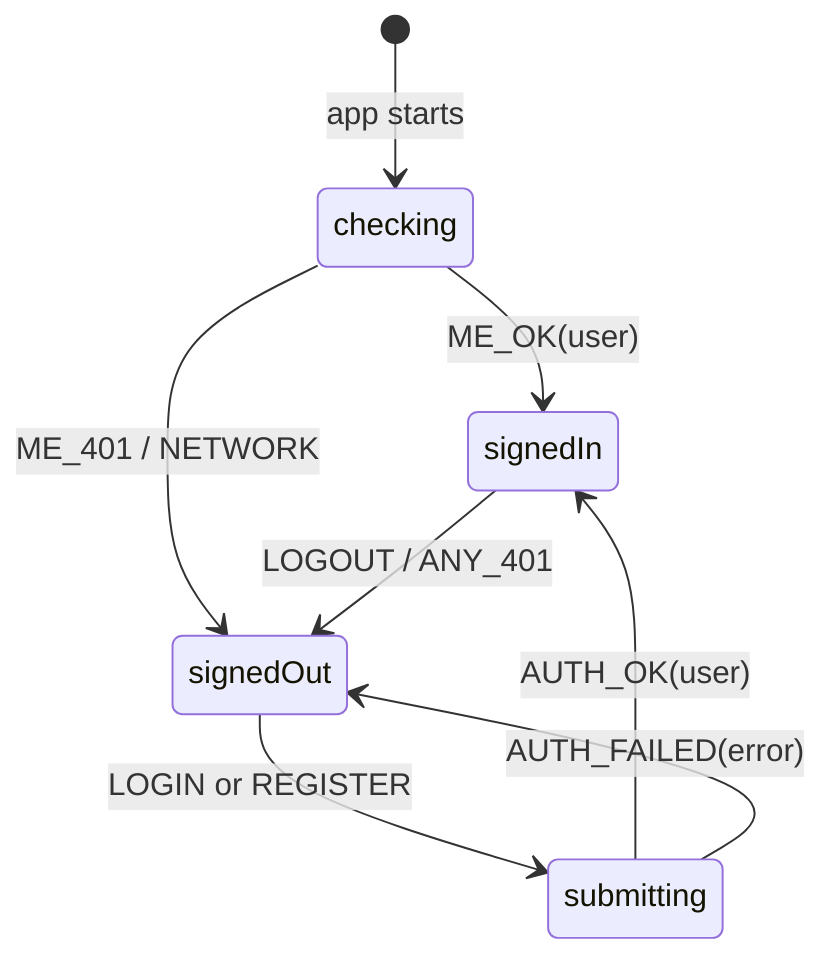
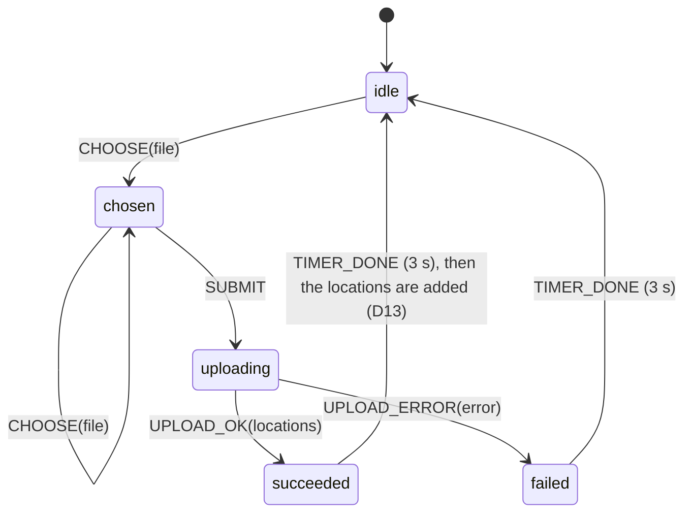
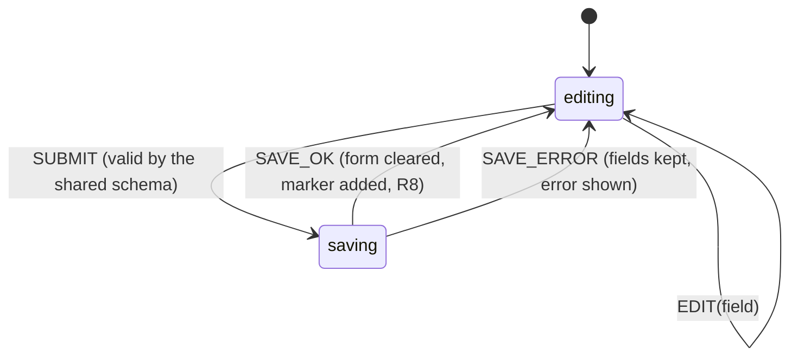

# State machines

Each flow with states is a pure reducer over a union of states, in the file named in its
heading, with a test that covers every (state, event) pair: the pairs the chart draws move to
the drawn state, and every other pair leaves the state unchanged. Components send events and
render the state; they do not decide transitions. A change to a chart here goes in the same
commit as the reducer and its test.

The charts are the design. The reducers do not exist yet; the issue that builds each one
links back here.

## Session (`apps/web/src/session/sessionMachine.ts`)

- `checking` renders a spinner on protected routes, never the login page (no redirect flash on refresh).
- `signedOut` on a protected route redirects to `/login` and remembers the route; `AUTH_OK` returns there (R4).
- `checking` calls `GET /api/auth/me`: under D6 the cookie is not readable by script, so the server is the only one who knows.

## Upload (`apps/web/src/upload/uploadMachine.ts`)

- The 3-second timer is started by the component on entering `succeeded` or `failed` and cleared on unmount; the reducer stays pure. Tests use fake timers.
- In `uploading`, `CHOOSE` and `SUBMIT` change nothing (no double upload).
- The popup is shown exactly while the state is `succeeded` or `failed` (R11, R12).

## Location form (`apps/web/src/map/locationFormMachine.ts`)

- `SUBMIT` with an invalid form stays in `editing` and shows the field errors; nothing is sent.
- The submit button is disabled in `saving` (D12).
