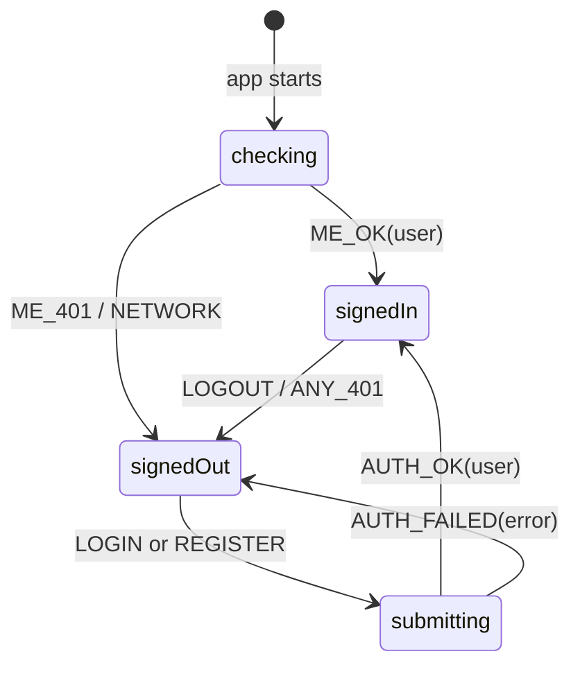
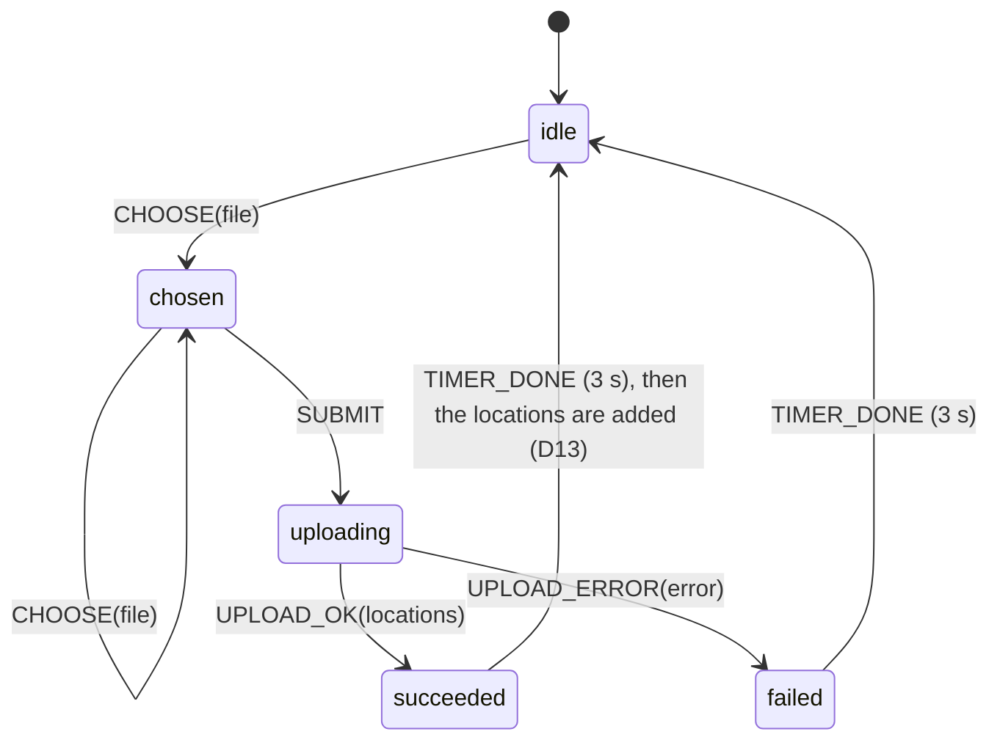
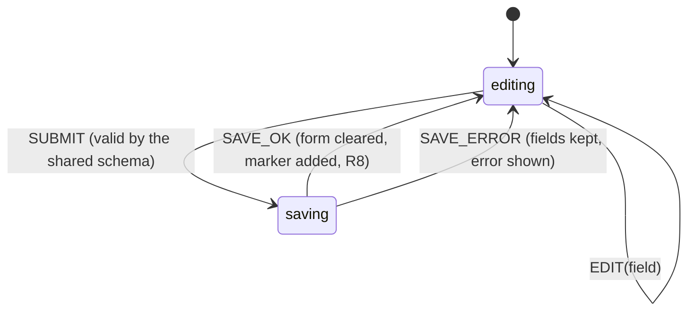

# State machines

Each flow with states is a pure reducer over a union of states (D19). Its heading names the file
and the transition table, which is data exported from that file. Two checks keep the three in
step:

- `node scripts/check-state-machines.mjs` (in `npm run ci`) fails when a chart's arrows and its
  table differ, or when a `*_TRANSITIONS` table has no chart here.
- The pair-table test (`checkMachine` in `apps/web/src/test/machine.ts`) runs every sample state
  against every sample event: a drawn pair ends in the drawn state (a guarded arrow may stay
  put), every other pair returns the same object, and every state, event and row needs a
  sample.

Components send events and render the state; they do not decide transitions. A change to a
chart goes in the same commit as its table, reducer and test. The tables and types exist; the
reducer bodies are filled by the issue each file names.

## Session (`apps/web/src/session/sessionMachine.ts`, `SESSION_TRANSITIONS`)

- `checking` renders a spinner on protected routes, never the login page (no redirect flash on refresh).
- `signedOut` on a protected route redirects to `/login` and remembers the route; `AUTH_OK` returns there (R4).
- `checking` calls `GET /api/auth/me`: under D6 the cookie is not readable by script, so the server is the only one who knows.

## Upload (`apps/web/src/upload/uploadMachine.ts`, `UPLOAD_TRANSITIONS`)

- The 3-second timer is started by the component on entering `succeeded` or `failed` and cleared on unmount; the reducer stays pure. Tests use fake timers.
- In `uploading`, `CHOOSE` and `SUBMIT` change nothing (no double upload).
- The popup is shown exactly while the state is `succeeded` or `failed` (R11, R12).

## Location form (`apps/web/src/map/locationFormMachine.ts`, `FORM_TRANSITIONS`)

- `SUBMIT` with an invalid form stays in `editing` and shows the field errors; nothing is sent.
- The submit button is disabled in `saving` (D12).
