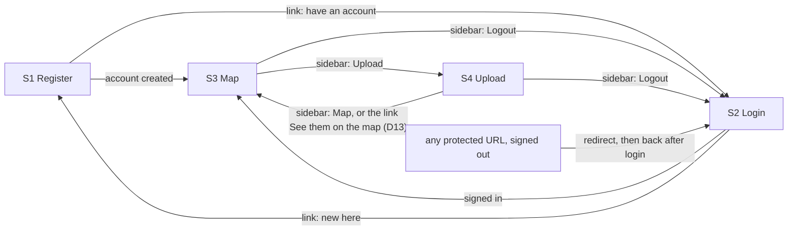

# UX flows and screens

The owner's map of the product: every screen state that gets a screenshot, every user task
(flow) with the most steps it may take, and how they connect. **This file is the source.**
The e2e flow specs read their step budgets from the Flows table, and
`node scripts/check-ux.mjs` (in `npm run ci`) fails when this file and the code disagree.

## How the owner takes part

| To | Do this |
|---|---|
| See every screen as it is on `main` | Open the [`ui-snapshots` branch, `main/latest/`](https://github.com/iskandarnorazli/LocationManagement/tree/ui-snapshots/main/latest) |
| See what a PR changes | Read the PR's "UI snapshots" comment: before (main) and after, desktop and phone, a filmstrip per flow, and a video of each flow (an inline GIF with a link to the full recording). Comment on it. |
| See a screen on any issue, now | Actions, "UI snapshots", Run workflow: the issue number and the state or flow ids (empty means all). The images arrive as a comment. |
| Report a bug | New issue, "Bug": where (a state or flow id below), steps, expected, actual, a screenshot. |
| Propose a UX change | New issue, "UX feedback", or edit the tables below in a PR. A budget you lower fails the flow's spec until the UI meets it. |
| Ask for a review | Agents label UI PRs `needs-owner-review`; your comment on the snapshot comment is the review. |

## What counts as a step

One deliberate user action: a click or tap, filling one field (typing a whole value counts
once), choosing a file, pressing a key such as Enter. Waiting, reading, scrolling and an
automatic redirect are not steps. A flow spec wraps each action in `step(label, action)`, and
saves a screenshot after it.

## Map

The layout is D23 (layout D): a full-screen map with the form in a bottom sheet that swipes up
to the list, and an upload page with the list beside it. Screenshots are in `docs/design/`.

## Screens

Each row is one state that gets a screenshot at desktop (1440 x 900) and phone (390 x 844)
width. `planned` rows are captured once the page exists; the issue that builds a page changes
its rows to `built` and adds the setup in `e2e/screens.ts`.

| State | Screen | What it shows | Status |
|---|---|---|---|
| S1.empty | Register | Empty form | built |
| S1.invalid | Register | Field errors after submitting an invalid email and a short password | built |
| S1.taken | Register | "An account with this email already exists." | built |
| S2.empty | Login | Empty form | built |
| S2.wrong | Login | "Email or password is incorrect." | built |
| S3.empty | Map | A new user's map: no markers, the form empty | built |
| S3.markers | Map | Three markers in Kuala Lumpur | built |
| S3.popup | Map | A marker's popup showing its name (R9) | built |
| S3.invalid | Map | The form with latitude 91: field error, nothing sent | built |
| S3.nav | Map | Phone: the sidebar drawer open over the map (R2, D23) | built |
| S3.sheetOpen | Map | The sheet swiped up: the form and "Your locations (3)" (D23) | built |
| S3.focus | Map | Opened from "See them on the map": zoomed to the new markers, sheet open, new rows highlighted (D13) | built |
| S4.idle | Upload | No file chosen | built |
| S4.chosen | Upload | A file chosen, ready to send | built |
| S4.success | Upload | The success popup (R11) | built |
| S4.error | Upload | The error popup for a ZIP with two files (R12) | built |
| S4.afterStay | Upload | After the success popup: the new rows highlighted in the list, with the link to the map (D13) | built |

## Flows

`Budget` is the most steps the flow may take. `enforced` means `e2e/flows/<Flow>.spec.ts`
exists and fails CI over budget; `planned` means its pages are not built yet.

| Flow | Task | Starts on | Budget | Status | Requirements |
|---|---|---|---|---|---|
| F1 | Create an account | S1, empty | 3 | enforced | R1, R3 |
| F2 | Sign in | S2, empty | 3 | enforced | R1, R3 |
| F3 | Add a location with the form | S3, signed in | 4 | enforced | R7, R8 |
| F4 | See a location's name | S3 with markers | 1 | enforced | R9 |
| F5 | Import locations from a ZIP | S3, signed in | 3 | enforced | R10, R11 |
| F6 | Sign out | S3, signed in | 1 | enforced | R2 |
| F7 | Open a protected page while signed out, sign in, land on that page | a protected URL | 3 | enforced | R4 |

Why these budgets: F1 and F2 are two fields and a button. F3 is three fields and a button; a
design that fills the coordinates from a map click could lower it to 3, a question for the
design session. F5 is: open Upload, choose the file, send; the popup and the markers need no
step.
